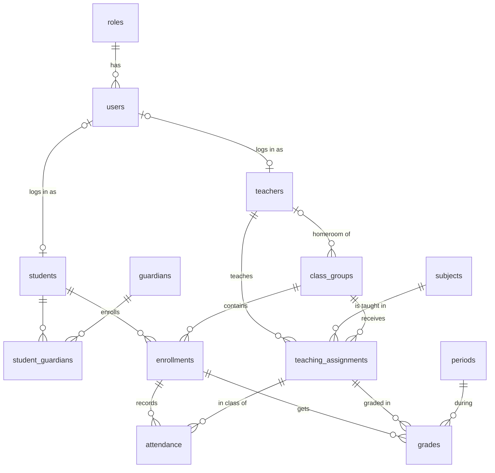

# SARAIS — Relational Data Dictionary (MySQL 8.4)

All tables use `ENGINE=InnoDB`, `CHARSET=utf8mb4`, `COLLATE=utf8mb4_0900_ai_ci`.
Source of truth: `db/ddl.sql`. All sample data is synthetic (`db/dml.sql`).

Key legend: **PK** primary key · **FK** foreign key · **UQ** unique · **CK** check constraint.

## Entity-relationship overview

## Referential actions (ON DELETE)

| Policy | Where | Reason |
|---|---|---|
| RESTRICT | users→roles; teaching_assignments, enrollments, grades, attendance → parents | Academic history must never disappear by accident. |
| CASCADE | student_guardians → students / guardians | A pure link row has no meaning without both sides. |
| SET NULL | students.user_id, teachers.user_id, class_groups.homeroom_teacher_id | Deleting an account or a teacher must not delete the person or the group. |

All FKs use `ON UPDATE CASCADE`.

---

## 1. roles
Catalog of system roles for RBAC.

| Column | Type | Null | Key | Description |
|---|---|---|---|---|
| role_id | TINYINT UNSIGNED | No | PK, AI | Role identifier |
| role_name | VARCHAR(20) | No | UQ, CK | `admin`, `teacher` or `student` |
| description | VARCHAR(150) | Yes | | What the role can do |

## 2. users
Login accounts. Stores authentication and lockout state.

| Column | Type | Null | Key | Description |
|---|---|---|---|---|
| user_id | INT UNSIGNED | No | PK, AI | Account identifier |
| role_id | TINYINT UNSIGNED | No | FK→roles | Role of the account |
| username | VARCHAR(50) | No | UQ | Login name |
| email | VARCHAR(120) | No | UQ | Contact / login email |
| password_hash | VARCHAR(255) | No | | Argon2 hash created by the app (never plaintext) |
| mfa_enabled | TINYINT(1) | No | CK | 1 = TOTP required |
| mfa_secret_encrypted | VARBINARY(512) | Yes | CK | TOTP secret, encrypted by the app before storage |
| failed_attempts | TINYINT UNSIGNED | No | | Consecutive failed logins (default 0) |
| locked_until | DATETIME | Yes | | Lock expiry; NULL = not locked |
| is_active | TINYINT(1) | No | CK | 0 = disabled account |
| last_login_at | DATETIME | Yes | | Last successful login |
| created_at / updated_at | DATETIME | No | | Audit timestamps |

Rule `ck_users_mfa_secret`: if `mfa_enabled = 1`, the encrypted secret must exist.

## 3. students
Personal data of students. Personal data lives only in MySQL.

| Column | Type | Null | Key | Description |
|---|---|---|---|---|
| student_id | INT UNSIGNED | No | PK, AI | Student identifier |
| user_id | INT UNSIGNED | Yes | UQ, FK→users | Login account (optional) |
| document_type | CHAR(2) | No | UQ*, CK | TI, RC, CE, PA |
| document_number | VARCHAR(20) | No | UQ* | ID number (*unique together with type) |
| first_name / last_name | VARCHAR(60) | No | IDX | Names |
| birth_date | DATE | No | | Date of birth |
| gender | CHAR(1) | No | CK | F, M, O |
| address | VARCHAR(150) | Yes | | Home address |
| phone | VARCHAR(20) | Yes | | Phone |
| status | VARCHAR(12) | No | CK | active, inactive, graduated, withdrawn |
| created_at | DATETIME | No | | Creation timestamp |

## 4. guardians
Parents or legal guardians (acudientes).

| Column | Type | Null | Key | Description |
|---|---|---|---|---|
| guardian_id | INT UNSIGNED | No | PK, AI | Guardian identifier |
| document_type | CHAR(2) | No | UQ*, CK | CC, CE, PA |
| document_number | VARCHAR(20) | No | UQ* | ID number |
| first_name / last_name | VARCHAR(60) | No | IDX | Names |
| phone | VARCHAR(20) | No | | Main contact phone |
| email | VARCHAR(120) | Yes | | Email |
| address | VARCHAR(150) | Yes | | Address |
| created_at | DATETIME | No | | Creation timestamp |

## 5. student_guardians
N:M link between students and guardians.

| Column | Type | Null | Key | Description |
|---|---|---|---|---|
| student_id | INT UNSIGNED | No | PK, FK→students | Student |
| guardian_id | INT UNSIGNED | No | PK, FK→guardians | Guardian |
| relationship | VARCHAR(15) | No | CK | mother, father, grandparent, sibling, uncle_aunt, legal_guardian, other |
| is_primary | TINYINT(1) | No | CK | 1 = main contact |

## 6. teachers

| Column | Type | Null | Key | Description |
|---|---|---|---|---|
| teacher_id | INT UNSIGNED | No | PK, AI | Teacher identifier |
| user_id | INT UNSIGNED | Yes | UQ, FK→users | Login account (email is stored there) |
| document_type / document_number | CHAR(2) / VARCHAR(20) | No | UQ, CK | ID |
| first_name / last_name | VARCHAR(60) | No | | Names |
| phone | VARCHAR(20) | Yes | | Phone |
| specialty | VARCHAR(80) | No | | Professional degree |
| hire_date | DATE | No | | Hire date |
| is_active | TINYINT(1) | No | CK | 1 = active |

## 7. subjects

| Column | Type | Null | Key | Description |
|---|---|---|---|---|
| subject_id | SMALLINT UNSIGNED | No | PK, AI | Subject identifier |
| subject_code | VARCHAR(10) | No | UQ | Short code (e.g. MAT01) |
| subject_name | VARCHAR(80) | No | UQ | Name |
| area | VARCHAR(60) | No | | Curriculum area |
| weekly_hours | TINYINT UNSIGNED | No | CK | 1–10 hours per week |

## 8. class_groups
A course in a given year (e.g. grade 6, section A, 2026). Named `class_groups` because `GROUPS` is a reserved word in MySQL 8.

| Column | Type | Null | Key | Description |
|---|---|---|---|---|
| class_group_id | INT UNSIGNED | No | PK, AI | Group identifier |
| academic_year | SMALLINT UNSIGNED | No | UQ*, CK | School year |
| grade_level | TINYINT UNSIGNED | No | UQ*, CK | 0 (transition) to 11 |
| section | CHAR(1) | No | UQ*, CK | A–Z |
| homeroom_teacher_id | INT UNSIGNED | Yes | FK→teachers | Homeroom teacher |
| classroom | VARCHAR(20) | Yes | | Room |

The display name ("6A") is **not stored**; it is derived from `grade_level` + `section`.

## 9. periods

| Column | Type | Null | Key | Description |
|---|---|---|---|---|
| period_id | TINYINT UNSIGNED | No | PK, AI | Period identifier |
| academic_year | SMALLINT UNSIGNED | No | UQ* | School year |
| period_number | TINYINT UNSIGNED | No | UQ*, CK | 1–4 |
| start_date / end_date | DATE | No | CK | `end_date > start_date` |
| weight_percent | DECIMAL(5,2) | No | CK | Weight in final grade (0–100] |
| is_closed | TINYINT(1) | No | CK | 1 = grades can no longer change |

## 10. teaching_assignments
Which teacher teaches which subject to which group.

| Column | Type | Null | Key | Description |
|---|---|---|---|---|
| assignment_id | INT UNSIGNED | No | PK, AI | Assignment identifier |
| teacher_id | INT UNSIGNED | No | FK→teachers | Teacher |
| subject_id | SMALLINT UNSIGNED | No | UQ*, FK→subjects | Subject |
| class_group_id | INT UNSIGNED | No | UQ*, FK→class_groups | Group |

`UQ (subject_id, class_group_id)`: one teacher per subject per group.

## 11. enrollments

| Column | Type | Null | Key | Description |
|---|---|---|---|---|
| enrollment_id | INT UNSIGNED | No | PK, AI | Enrollment identifier |
| student_id | INT UNSIGNED | No | UQ*, FK→students | Student |
| class_group_id | INT UNSIGNED | No | UQ*, FK→class_groups | Group |
| enrollment_date | DATE | No | | Date of enrollment |
| status | VARCHAR(10) | No | CK | active, withdrawn, completed |

## 12. grades

| Column | Type | Null | Key | Description |
|---|---|---|---|---|
| grade_id | INT UNSIGNED | No | PK, AI | Grade identifier |
| enrollment_id | INT UNSIGNED | No | UQ*, FK→enrollments | Who |
| assignment_id | INT UNSIGNED | No | UQ*, FK→teaching_assignments | Subject + teacher |
| period_id | TINYINT UNSIGNED | No | UQ*, FK→periods | When |
| score | DECIMAL(3,2) | No | CK | 0.00 – 5.00 |
| observation | VARCHAR(255) | Yes | | Teacher comment |
| recorded_at / updated_at | DATETIME | No | | Timestamps |

## 13. attendance

| Column | Type | Null | Key | Description |
|---|---|---|---|---|
| attendance_id | INT UNSIGNED | No | PK, AI | Record identifier |
| enrollment_id | INT UNSIGNED | No | UQ*, FK→enrollments | Who |
| assignment_id | INT UNSIGNED | No | UQ*, FK→teaching_assignments | Which class |
| class_date | DATE | No | UQ*, IDX | Day of class (period is derived from it) |
| status | VARCHAR(8) | No | CK | present, absent, late, excused |
| notes | VARCHAR(255) | Yes | | Comment |
| recorded_at | DATETIME | No | | Timestamp |

## View: v_report_card
One row per student × period × subject: year, period, group, student, subject, area, teacher, score, performance level (Bajo < 3.0, Básico 3.0–3.99, Alto 4.0–4.59, Superior ≥ 4.6) and number of absences inside the period dates.

## Encryption at rest
Tables are created without `ENCRYPTION='Y'` because it fails until the keyring component is configured. The `ALTER TABLE ... ENCRYPTION='Y'` statements are ready, commented, at the end of `db/ddl.sql`.

## Known rules enforced by the application (not by the schema)
- A student should have only one active enrollment per academic year.
- In `grades` and `attendance`, the assignment must belong to the same group as the enrollment.
- Grades of a closed period (`is_closed = 1`) must not be modified.
